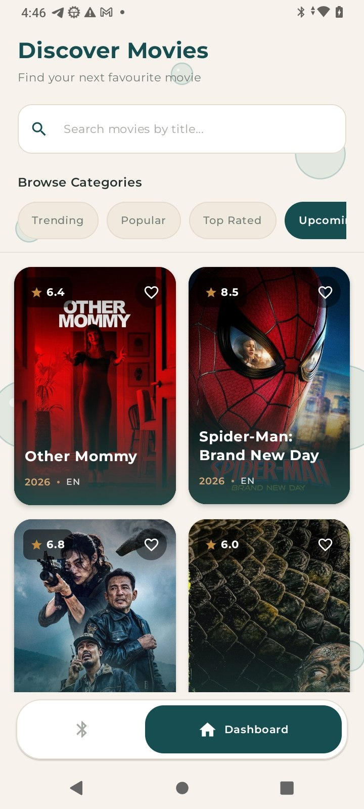

# Movie Explorer – Android Application

A native Android application built using **Kotlin, XML layouts, and Android Jetpack components**.

Movie Explorer allows users to discover movies, search for movies, explore different categories, view detailed movie information, and save their favourite movies.

The application uses **The Movie Database (TMDB) API** to retrieve movie information and artwork.

## Project Overview

Movie Explorer provides three main screens:

1. **Login Screen** – A login interface with email and password validation using local validation logic.
2. **Movie Explorer** – Browse trending, popular, top-rated, upcoming, and favourite movies.
3. **Movie Detail Screen** – View movie posters, backdrops, ratings, release dates, descriptions, and other information.

The application is developed using XML-based Android UI layouts rather than Jetpack Compose.

---

## Screenshots

Place your latest application screenshots in the `screenshots/` directory.

### Login Screen


### Movie Explorer

| Trending Movies | Movie Search | Movie Categories |
|---|---|---|
|  |  |  |

### Movie Details


*Update the screenshot filenames if your actual image filenames are different.*

---

## Features

### 1. Login Screen

The application starts with a login screen.

Implemented functionality:

- Email input field.
- Password input field.
- Password visibility toggle.
- Email format validation.
- Required-field validation.
- Minimum password length validation.
- Login button with validation feedback.
- Navigation to Movie Explorer after successful local validation.

**Note:** Login currently uses local validation only. It does not authenticate users through a backend, Firebase, or a remote authentication service.

### 2. Movie Explorer

The Movie Explorer screen retrieves movie information from the TMDB API.

Implemented functionality:

- **Trending Movies:** Discover currently trending movies.
- **Popular Movies:** Browse popular movies.
- **Top Rated Movies:** Explore highly rated movies.
- **Upcoming Movies:** Discover upcoming releases.
- **Favourites:** View movies saved as favourites.
- **Movie Grid:** Display movies in a two-column grid layout.
- **Movie Search:** Search movies by title.
- **Person Search:** Support searching for people and retrieving their movie credits, where enabled.
- **Debounced Search:** Wait approximately 400 milliseconds after the latest search input before triggering a search.
- **Pagination:** Load additional movie results when scrolling near the bottom of the list.
- **Search Keyboard Handling:** Hide the keyboard and scroll the Movie Explorer to the top when submitting a search.
- **Loading Indicator:** Display a full-screen circular progress indicator while movie data is loading, including when switching categories.
- **Empty State:** Display an appropriate message when no movies are available.
- **Error Handling:** Provide a retry option when an API request fails.

### 3. Movie Detail Screen

Selecting a movie opens its dedicated detail screen.

Implemented functionality:

- Movie backdrop image.
- Movie poster image.
- Movie title.
- Release year.
- Movie rating.
- Original language.
- Movie overview.
- Original movie title.
- Total vote count.
- Add to Favourites button.
- Remove from Favourites functionality.
- Back navigation to Movie Explorer.

Movie images are loaded using Coil.

### 4. Favourite Movies

Users can save movies to their favourites list.

Implemented functionality:

- Add movies to favourites.
- Remove movies from favourites.
- Display saved movies in the Favourites category.
- Maintain favourite movie data locally using Android SharedPreferences and Gson serialization.
- Preserve saved favourites across application restarts.

---

## Technology Stack

| Technology | Purpose |
|---|---|
| Kotlin | Primary programming language |
| XML Layouts | Android UI development |
| Android Views | UI components |
| ViewBinding | Access XML views safely |
| Material Components | UI components and styling |
| ConstraintLayout | Flexible screen layouts |
| LinearLayout | Organize UI components |
| FrameLayout | Layered UI and loading overlays |
| NestedScrollView | Scrollable screens |
| RecyclerView | Display movie lists |
| Navigation Component | Screen navigation |
| MVVM | Application architecture |
| StateFlow | Reactive UI state management |
| Kotlin Coroutines | Asynchronous operations |
| Retrofit | REST API communication |
| OkHttp | HTTP client |
| Coil | Movie image loading |
| Hilt | Dependency injection |
| Gson | JSON serialization |
| SharedPreferences | Local favourite storage |
| Gradle | Build automation |

**Development environment**

- Android Studio
- JDK 17
- Android SDK
- Kotlin
- Gradle

---

## Architecture

The application follows the **MVVM (Model–View–ViewModel)** architecture with separation between presentation, data, and network responsibilities.

### Architecture Overview

```text
User Interface (XML)
        |
        v
Fragments
        |
        v
ViewModel
        |
        v
Repository
       / \
      /   \
     v     v
 TMDB API  Local Storage
 Retrofit  SharedPreferences
     \     /
      \   /
       v
    UI State
    StateFlow
       |
       v
 Fragments update UI
```

### Main Responsibilities

**Presentation Layer**

- Displays application screens using XML layouts.
- Handles user interactions.
- Observes ViewModel state.
- Updates the UI based on loading, success, and error states.

**ViewModel Layer**

- `ApiViewModel` manages Movie Explorer state and actions.
- Handles category selection.
- Manages movie search.
- Coordinates pagination.
- Manages favourite operations.
- Loads selected movie details.
- Exposes UI state using Kotlin StateFlow.

**Data Layer**

- `MovieRepository` manages movie data operations.
- Retrieves information from the TMDB API.
- Provides access to locally stored favourite movies.

**Network Layer**

- Retrofit defines TMDB API endpoints.
- OkHttp handles HTTP requests.
- Bearer-token authentication is used for API requests.
- Gson handles JSON serialization.

**Dependency Injection**

- Hilt manages dependency injection across the application.

---

## Project Structure

The project uses a feature-based package structure.

```text
com.example.exam
│
├── core
│   ├── common
│   │   └── Constants.kt
│   ├── network
│   └── navigation
│
├── data
│   ├── local
│   │   └── FavouriteMoviesStore.kt
│   │
│   ├── remote
│   │   ├── ApiService.kt
│   │   └── model
│   │
│   └── repository
│       └── MovieRepository.kt
│
├── di
│   └── NetworkModule.kt
│
├── feature
│   ├── login
│   │   └── presentation
│   │
│   └── api
│       └── presentation
│           ├── ApiFragment.kt
│           ├── ApiViewModel.kt
│           ├── MovieDetailFragment.kt
│           └── MovieGridAdapter.kt
│
└── ui
    └── theme
```

### Important XML Resources

```text
res
│
├── layout
│   ├── activity_main.xml
│   ├── fragment_login.xml
│   ├── fragment_api.xml
│   ├── fragment_device_detail.xml
│   └── item_movie.xml
│
├── navigation
│   └── nav_graph.xml
│
├── drawable
│   ├── bg_back_button.xml
│   └── ic_arrow_back.xml
│
├── values
│   ├── colors.xml
│   ├── strings.xml
│   └── themes.xml
│
└── mipmap
```

*The structure above describes the current intended organization. Adjust filenames or folders if they differ in your local project.*

---

## TMDB API Integration

The application uses The Movie Database (TMDB) REST API.

**API Base URL**

```text
https://api.themoviedb.org/3/
```

**Image URLs**

Poster images:

```text
https://image.tmdb.org/t/p/w500
```

Backdrop images:

```text
https://image.tmdb.org/t/p/original
```

### API Endpoints

| Feature | Endpoint |
|---|---|
| Trending Movies | `trending/movie/day` |
| Popular Movies | `movie/popular` |
| Top Rated Movies | `movie/top_rated` |
| Upcoming Movies | `movie/upcoming` |
| Search Movies | `search/movie` |
| Search People | `search/person` |
| Person Movie Credits | `person/{person_id}/movie_credits` |
| Movie Details | `movie/{movie_id}` |

Movie details can also request additional credits using:

```text
append_to_response=credits
```

### API Authentication

The application uses a TMDB Bearer token for API authentication.

The token is configured through the application's network configuration.

**Important security recommendation:**

Do not commit real API tokens or credentials to a public GitHub repository.

Use a local, untracked configuration file or a secure build-time secrets mechanism. If a credential has already been exposed publicly, revoke or rotate it.

For TMDB documentation, visit:

https://developer.themoviedb.org/docs

---

## Android Configuration

Current project configuration:

| Setting | Value |
|---|---|
| Application ID | `com.example.exam` |
| Namespace | `com.example.exam` |
| Minimum SDK | 26 |
| Compile SDK | 37 |
| Target SDK | 37 |
| Java Version | 17 |
| Kotlin JVM Toolchain | 17 |
| Version Code | 1 |
| Version Name | 1.0 |

Refer to `app/build.gradle.kts` for the latest dependency and build configuration.

---

## Android Permissions

The Movie Explorer requires network access.

The application uses:

| Permission | Purpose |
|---|---|
| `android.permission.INTERNET` | Connect to TMDB API and retrieve movie images |
| `android.permission.ACCESS_NETWORK_STATE` | Access network connectivity information |

No Bluetooth or BLE permissions are required.

---

## Getting Started

### Requirements

Before running the project, make sure you have:

- Android Studio installed.
- JDK 17 installed.
- Android SDK configured.
- A valid TMDB API Bearer token.
- Internet access.

### 1. Clone the Repository

```bash
git clone <YOUR_REPOSITORY_URL>
```

Navigate to the project directory:

```bash
cd Exam
```

### 2. Open the Project

1. Open Android Studio.
2. Select Open Project.
3. Choose the cloned project directory.
4. Wait for Gradle synchronization to finish.

### 3. Configure TMDB API Credentials

Configure your TMDB Bearer token in the appropriate local configuration used by the network layer.

Do not upload private credentials to GitHub.

### 4. Build the Application

On macOS or Linux:

```bash
./gradlew :app:assembleDebug
```

On Windows:

```bash
gradlew.bat :app:assembleDebug
```

### 5. Run the Application

You can run the application directly from Android Studio using an emulator or a connected Android device.

### 6. Generate Debug APK

The debug APK will be generated at:

```text
app/build/outputs/apk/debug/app-debug.apk
```

Install it using ADB:

```bash
adb install -r app/build/outputs/apk/debug/app-debug.apk
```

---

## Known Limitations

- **Local Login:** The login screen currently validates input locally and does not provide real user authentication.
- **Internet Dependency:** Movie categories, search, and movie details require an internet connection.
- **API Availability:** Movie information depends on TMDB API availability and valid authentication credentials.
- **Image Availability:** Some movies may not have poster or backdrop images available.
- **Favourite Storage:** Favourite movies are stored locally on the device and are not synchronized across devices or accounts.
- **Search Results:** Search results depend on the data returned by TMDB.
- **Pagination:** Additional movies are loaded when the user scrolls through the movie list.

---

## Credits

- Movie information and images are provided by [The Movie Database (TMDB)](https://www.themoviedb.org/).
- This product uses the TMDB API but is not endorsed or certified by TMDB.

---

## Project Status

**Movie Explorer – Kotlin + XML Android Application**

The project is focused on a native Android movie-discovery experience with local login validation, TMDB API integration, movie browsing, search, movie details, and local favourites.

BLE Device Scanner functionality has been removed from the current project scope.
