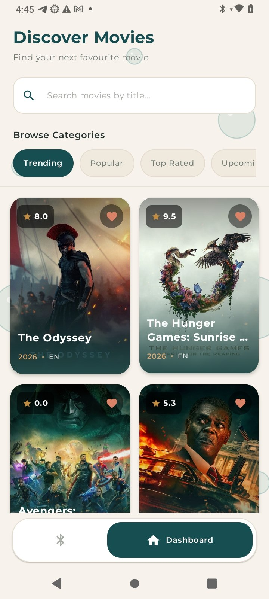
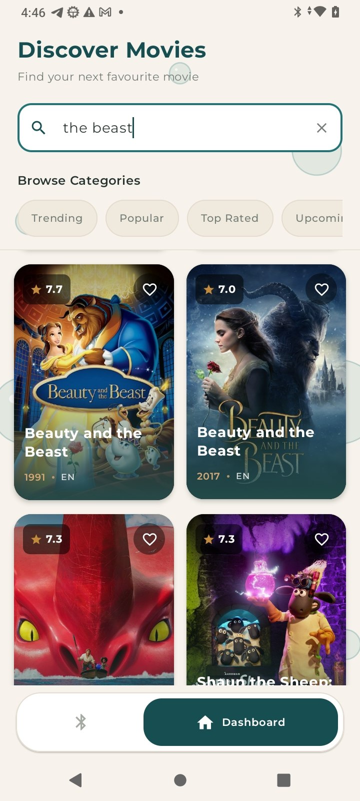
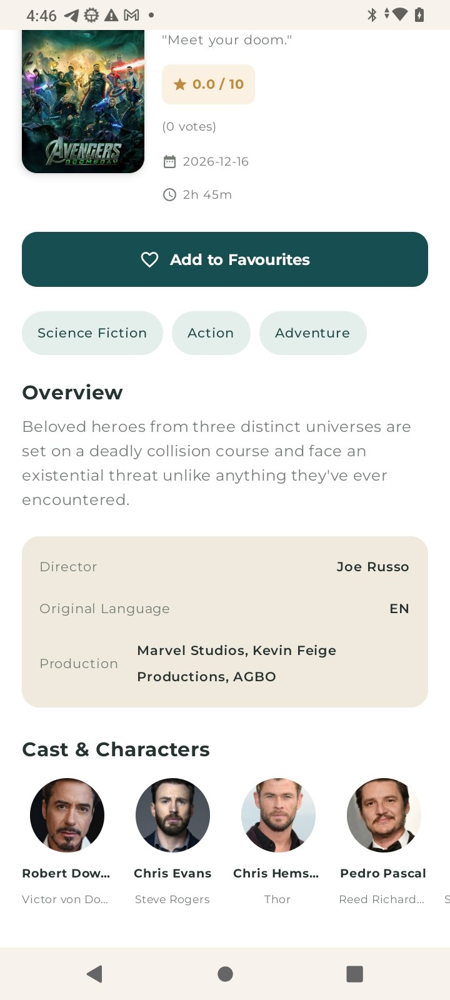
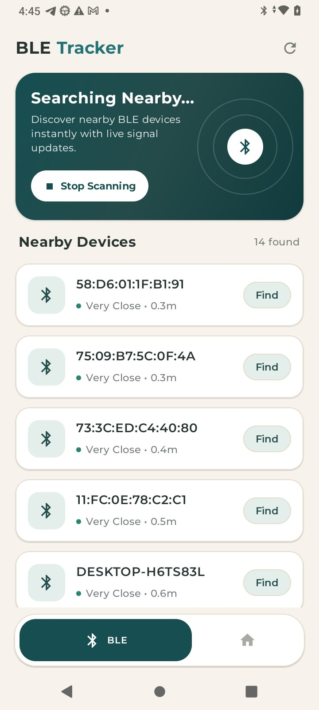
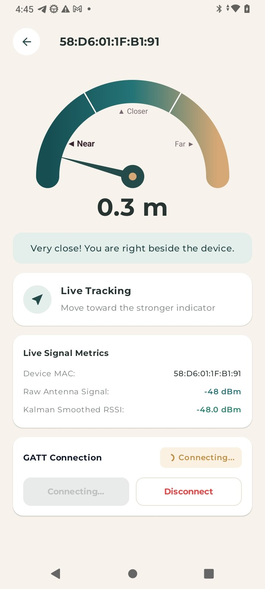
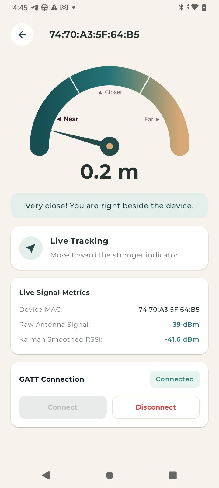

# Movie Explorer & BLE Device Scanner

A native Android application built with **Kotlin** and **Jetpack Compose**. The project brings together two independent app experiences:

- **Movie Explorer** — browse movies from The Movie Database (TMDB), search by movie title or person, view movie details, and save favourites locally.
- **BLE Device Scanner** — discover nearby Bluetooth Low Energy devices, inspect signal strength, connect to a device over GATT, and view an estimated proximity distance.

The app uses a layered MVVM structure, Hilt dependency injection, Kotlin Coroutines and Flow, Retrofit, and Material 3.

> **Project status:** This README was checked against the source code and Gradle configuration included in this repository archive. It describes the implementation visible in that source snapshot; it does not claim that a fresh build or runtime test was performed as part of the documentation review.

---

## Screenshots

The screenshots below are included in the [`screenshots/`](screenshots/) directory.

### Movie Explorer

| Trending movies | Search movies | Upcoming movies |
|---|---|---|
|  |  |  |

### Movie details



### BLE Device Scanner

| Nearby BLE devices | Device details | Live tracking |
|---|---|---|
|  |  |  |

---

## Project Overview

### 1. Movie Explorer

The Movie Explorer feature uses TMDB's REST API to retrieve movie and person information.

Implemented functionality:

- **Movie categories:** Trending, Popular, Top Rated, Upcoming, and Favourites.
- **Movie grid:** a two-column Compose grid displaying poster artwork and movie information.
- **Movie search:** searches TMDB by movie title.
- **Person search:** searches TMDB people, then loads movie credits for the first matching person returned by the API.
- **Debounced input:** waits 400 ms after the latest search text change before starting a search.
- **Pagination:** loads additional pages for category browsing and movie-title search.
- **Movie details:** requests a movie detail response with `credits` appended. The detail UI displays available movie information such as overview, runtime, genres, director, and cast.
- **Favourites:** saves and removes favourite movies using Android `SharedPreferences`, with Gson serialization. Favourites remain available after app restarts.

**Offline behaviour:** Favourite movie data is stored locally. The category feeds, search, and movie-detail requests use TMDB and therefore require network access. The project declares `ACCESS_NETWORK_STATE`, but this source snapshot does not contain a dedicated connectivity observer or a separate full-screen offline state.

### 2. BLE Device Scanner

The BLE feature discovers nearby Bluetooth Low Energy peripherals and provides a device detail view for signal and connection information.

Implemented functionality:

- **BLE scanning:** discovers nearby BLE devices and presents them in a device list.
- **Runtime permissions:** requests the Bluetooth permissions required by the Android version.
- **Animated radar visual:** a Compose Canvas-based animated radar graphic is used in the scanner screen.
- **Device detail screen:** displays the selected device's signal information, estimated distance, proximity level, and GATT connection state.
- **GATT operations:** supports connecting and disconnecting, reading characteristics, writing characteristics, and enabling/disabling notifications through the BLE GATT client.
- **RSSI smoothing:** applies a per-device 1D Kalman filter to scan RSSI readings and maintains a rolling FIFO buffer of up to 10 filtered values.
- **Distance estimate:** converts RSSI to an estimated distance using a log-distance path-loss formula. The configured defaults are TX power `-59 dBm` and path-loss exponent `2.2`.
- **Proximity gauge:** displays a semi-circular gauge with Near, Closer, and Far zones.
- **Tracked-device signal feed:** while a device is being tracked, the manager combines GATT-polled RSSI with the scanner's tracked-device advertisement RSSI, preferring the GATT value when available.

**Distance accuracy note:** RSSI-based distance is an estimate, not a precise measurement. Walls, device orientation, antenna differences, interference, and the environment can change signal strength.

---

## Architecture

The source code follows a presentation/data separation with MVVM and repository-based data access.

```text
com.example.exam
├── core
│   ├── bluetooth
│   │   ├── BleManager
│   │   ├── BleScanner
│   │   ├── BleGattClient
│   │   ├── BlePermissionHelper
│   │   ├── model
│   │   └── signal
│   │       ├── KalmanFilter
│   │       ├── RssiWindowBuffer
│   │       └── DistanceEstimator
│   ├── common
│   ├── navigation
│   └── network
├── data
│   ├── local
│   │   └── FavouriteMoviesStore
│   ├── remote
│   │   └── ApiService
│   └── repository
│       └── MovieRepository
├── di
│   ├── NetworkModule
│   └── BleModule
├── feature
│   ├── api
│   │   └── presentation
│   └── ble
│       └── presentation
└── ui
    └── theme
```

### Main responsibilities

- **Presentation:** Compose screens and UI components render state and forward user actions to ViewModels.
- **ViewModels:** `ApiViewModel` and `BleViewModel` expose UI state using Kotlin `StateFlow` and coordinate feature actions.
- **Repository:** `MovieRepository` provides a single access point for TMDB requests and locally stored favourites.
- **Network layer:** Retrofit defines TMDB endpoints; OkHttp configures timeouts, Bearer-token authentication, and debug logging. API calls are wrapped by `safeApiCall`.
- **BLE coordination:** `BleManager` coordinates `BleScanner` and `BleGattClient` and exposes BLE state to the ViewModel.
- **Dependency injection:** Hilt modules provide network and BLE dependencies.

---

## Technology Stack

Versions below are taken from `gradle/libs.versions.toml`, `gradle/wrapper/gradle-wrapper.properties`, and the module Gradle file in the uploaded project snapshot.

| Technology | Configured version |
|---|---:|
| Android Gradle Plugin | `9.4.1` |
| Gradle wrapper | `9.6.0` |
| Kotlin | `2.2.10` |
| Jetpack Compose BOM | `2026.02.01` |
| AndroidX Core KTX | `1.19.1` |
| Lifecycle | `2.11.0` |
| Activity Compose | `1.13.0` |
| Navigation Compose | `2.8.8` |
| Retrofit | `2.11.0` |
| OkHttp | `4.12.0` |
| Coil Compose | `2.7.0` |
| Kotlinx Coroutines | `1.10.1` |
| Hilt | `2.60.1` |
| Hilt Navigation Compose | `1.2.0` |
| KSP | `2.3.6` |
| Gson | Provided through Retrofit's Gson converter |

Other implementation technologies include Material 3, Compose Material Icons Extended, Java 17 toolchain, and AndroidX Lifecycle-aware state collection.

---

## Android App Configuration

The values below are read from `app/build.gradle.kts`:

| Setting | Configured value |
|---|---:|
| Application ID | `com.example.exam` |
| Namespace | `com.example.exam` |
| `versionCode` | `1` |
| `versionName` | `1.0` |
| `minSdk` | `26` |
| `compileSdk` | `37` |
| `targetSdk` | `37` |
| Java source/target compatibility | `17` |
| Kotlin JVM toolchain | `17` |

The launcher label is currently `Exam`, as configured in `app/src/main/res/values/strings.xml`.

---

## TMDB API Configuration

The Movie Explorer uses the TMDB v3 API.

- **API base URL:** `https://api.themoviedb.org/3/`
- **Poster image base URL:** `https://image.tmdb.org/t/p/w500`
- **Backdrop image base URL:** `https://image.tmdb.org/t/p/original`

The Retrofit service currently defines these endpoints:

| Feature | TMDB endpoint |
|---|---|
| Trending movies | `trending/movie/day` |
| Popular movies | `movie/popular` |
| Top-rated movies | `movie/top_rated` |
| Upcoming movies | `movie/upcoming` |
| Search movies | `search/movie` |
| Search people | `search/person` |
| Person movie credits | `person/{person_id}/movie_credits` |
| Movie details and credits | `movie/{movie_id}` with `append_to_response=credits` |

### API credentials

The current source reads the TMDB Bearer token from `core/common/Constants.kt`, and `ApiClient` adds it to outgoing requests using the `Authorization` header.

**Before publishing this repository:** do not commit API keys or access tokens in source control. The uploaded source snapshot contains a credential value in `Constants.kt`. Revoke or rotate that credential if it has been shared publicly, then move credentials into a local, untracked configuration or a secure build-time secrets process. Do not paste real credentials into this README.

---

## Android Permissions

The manifest declares the following permissions:

### Network

- `android.permission.INTERNET` — TMDB API and remote image requests.
- `android.permission.ACCESS_NETWORK_STATE` — network-state access.

### Bluetooth on Android 12 (API 31) and newer

- `android.permission.BLUETOOTH_SCAN` — BLE scanning; declared with `neverForLocation`.
- `android.permission.BLUETOOTH_CONNECT` — Bluetooth device connection and GATT access.

### Legacy Bluetooth and location permissions

- `android.permission.BLUETOOTH` — declared for API 30 and below.
- `android.permission.BLUETOOTH_ADMIN` — declared for API 30 and below.
- `android.permission.ACCESS_FINE_LOCATION` — declared for API 30 and below.
- `android.permission.ACCESS_COARSE_LOCATION` — declared for API 28 and below.

The app also declares `android.hardware.bluetooth_le` as a required device feature. Devices without BLE hardware are therefore not intended targets for this app.

---

## Getting Started

### Requirements

- Android Studio with support for the configured Android Gradle Plugin.
- JDK 17.
- Android SDK platform 37 and the required build tools.
- A physical Android device with BLE hardware to test BLE scanning and GATT functionality.

### Clone and open

```bash
git clone <YOUR_REPOSITORY_URL>
cd Exam
```

Open the project directory in Android Studio and allow Gradle sync to finish.

### Build a debug APK

On macOS or Linux:

```bash
./gradlew assembleDebug
```

On Windows:

```bat
gradlew.bat assembleDebug
```

The expected debug APK location is:

```text
app/build/outputs/apk/debug/app-debug.apk
```

Install using ADB:

```bash
adb install -r app/build/outputs/apk/debug/app-debug.apk
```

BLE scanning and GATT behaviour should be tested on a physical BLE-capable Android device. Emulator support for real Bluetooth behaviour is limited and depends on the emulator environment.

---

## BLE Signal Processing Notes

The BLE implementation contains these signal-processing components:

1. **KalmanFilter:** a one-dimensional Kalman filter with configurable process and measurement noise.
2. **RssiWindowBuffer:** a FIFO buffer with a default capacity of 10 filtered RSSI values; it returns an arithmetic mean.
3. **DistanceEstimator:** estimates distance using:

   ```text
   distance = 10 ^ ((txPower - rssi) / (10 * pathLossExponent))
   ```

   The result is clamped to the range 0.1–30.0 metres and rounded to one decimal place.

The default proximity thresholds in the implementation are:

- **Very close:** less than 2 metres.
- **Getting closer:** 2 to 5 metres inclusive.
- **Far away:** greater than 5 metres.

These are application-side estimates based on configured constants and should be calibrated for the target hardware and environment if more reliable distance estimates are required.

---

## Known Limitations

- **Network dependency:** movie categories, title/person search, and movie details require a working connection to TMDB. Only favourites are persisted locally.
- **Estimated BLE distance:** RSSI-based distance can fluctuate and should not be treated as a precise ranging measurement.
- **Hardware dependency:** BLE scanning and GATT operations require a compatible physical device and nearby BLE peripherals.
- **Permission dependency:** BLE functionality depends on the user granting the required Bluetooth permissions and enabling Bluetooth.
- **TMDB credentials:** a valid TMDB Bearer token is required. Keep credentials out of public source control.
- **Device compatibility:** BLE scan results and GATT behaviour vary across Android versions and peripheral manufacturers.

---

## Source Layout

Important implementation files:

- `feature/api/presentation/ApiScreen.kt` — Movie Explorer screen.
- `feature/api/presentation/ApiViewModel.kt` — Movie Explorer state and actions.
- `feature/api/presentation/components/MovieCard.kt` — movie card UI.
- `feature/api/presentation/components/MovieDetailBottomSheet.kt` — movie details UI.
- `data/remote/ApiService.kt` — TMDB API endpoints.
- `data/repository/MovieRepository.kt` — movie data operations.
- `data/local/FavouriteMoviesStore.kt` — local favourite persistence.
- `feature/ble/presentation/BleScreen.kt` — BLE scanner screen.
- `feature/ble/presentation/DeviceDetailScreen.kt` — BLE device detail and tracking screen.
- `core/bluetooth/BleManager.kt` — scanner/GATT coordination.
- `core/bluetooth/BleScanner.kt` — BLE advertisements and RSSI processing.
- `core/bluetooth/BleGattClient.kt` — GATT connection and characteristic operations.
- `core/bluetooth/signal/` — Kalman filter, RSSI buffer, proximity and distance estimation.
- `ui/theme/` — app colors, typography, and Material theme.

---

## Credits

- Movie metadata and images are provided by [The Movie Database (TMDB)](https://www.themoviedb.org/).
- This product uses the TMDB API but is not endorsed or certified by TMDB.

